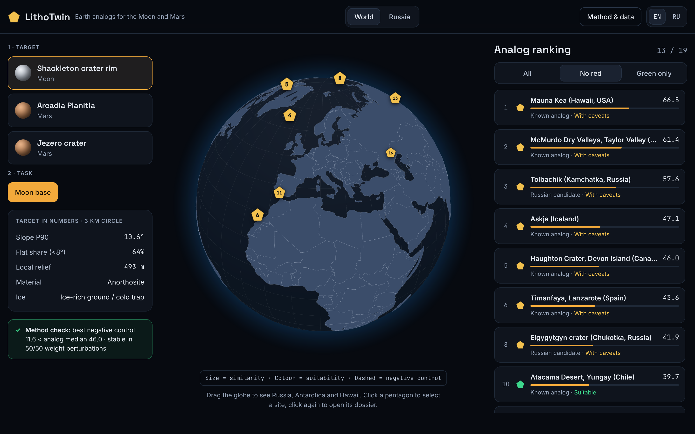
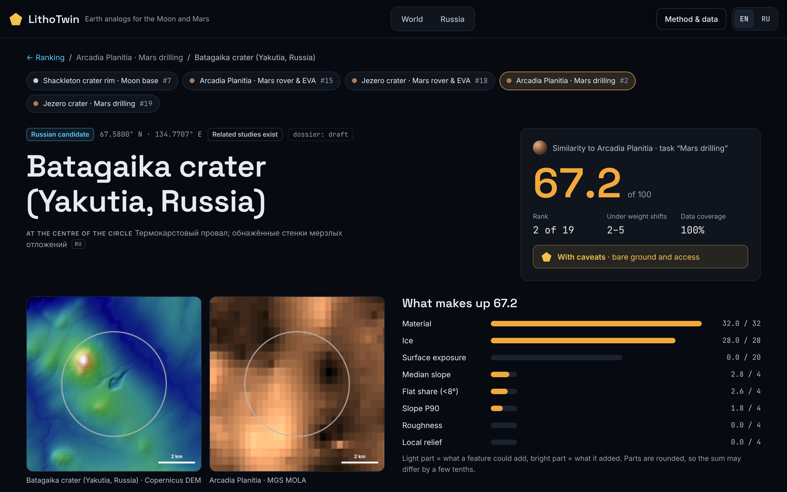
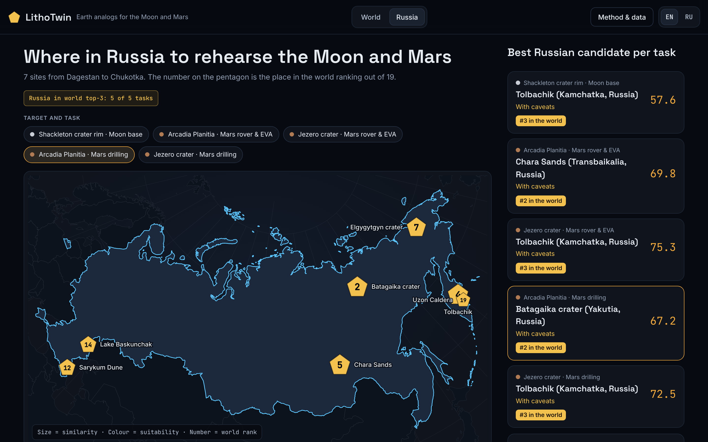

# LithoTwin

**Earth analogs for the Moon and Mars.** NASA Space Apps Challenge 2026, challenge #9.

LithoTwin answers one question: **where on Earth should we rehearse this specific Moon or Mars mission?**
Pick a target and a task: a Moon base on the Shackleton crater rim, or rover/EVA and drilling at Arcadia Planitia or Jezero crater on Mars. LithoTwin ranks 19 Earth sites by how closely their relief, rock and ice match the target, and shows a separate traffic light for whether a team can actually work there.

**Live demo:** https://wnfeelsgood-boop.github.io/LithoTwin44/



## What you can do

- **World**: a 3D globe with one pentagon per site. Size = similarity, colour = suitability, number = rank, dashed = negative control. The ranking next to it can be filtered: All / No red / Green only.
- **Dossier** for every site: the similarity score and what it is made of, relief figures next to the target's, suitability rules, what is similar and what differs, sources.
- **Russia**: the seven Russian candidates on a map, with their world rank for each task.
- **Method & data**: weights, tolerances, suitability rules, the validation check and the rock similarity matrix, rendered from the data files.

| Dossier | Russia |
|---|---|
|  |  |

## How it works

1. For every site and target we take a 3 km circle around its centre on a 500 m grid and compute five relief features: median slope, slope P90, flat share (< 8°), roughness and local relief.
2. Team geologists assign rock type (7 classes), ice (0–3), bare ground and access, with literature sources.
3. Each feature becomes a similarity from 0 to 1; a task-specific weighted mean gives the base score, and surface exposure adds up to 20 points.
4. Suitability is a separate verdict from simple rules (bare ground, access, flat area for a base, slopes for a rover, a drill target); the worst rule wins.
5. **Validation**: for every target × task pair, the best negative control (Amazon rainforest, Kansas farmland) must score below the median of the known analogs, and the result must hold when all weights are shifted by up to ±20% (50 runs). All 5 pairs pass.

Details: the **Method & data** page in the app, and `tools/compute_scores.py`.

## Run locally

Requires Node.js 20+.

```bash
npm install
npm test          # data integrity check
npm run dev       # http://localhost:5173
npm run build     # static site in dist/
npm run shots     # screenshots into docs/screenshots (after build)
npm run build:single  # one self-contained HTML file (dist-single/LithoTwin.html, ~10 MB) that opens from disk
```

The app is a static site: all numbers are precomputed in `public/data/*.json`; the browser only reads, filters and draws them. To update the data, replace the files in `public/data/` and `public/maps/` with a new data package of the same schema; no code changes are needed.

## Repository layout

```
src/            app code (vanilla JS + Vite)
  views/        world (globe + ranking), dossier, russia, about
  components/   pentagon marker, contribution bars, tables, pickers
public/data/    sites, features, scores, missions, labels, rock matrix (JSON)
public/maps/    10 × 10 km relief maps per site
public/geo/     country outlines (Natural Earth via world-atlas)
tools/          data check, scoring and relief scripts, screenshot script
docs/           AI disclosure, data gaps, screenshots
```

## Data sources and attribution

- **Earth relief:** Copernicus DEM GLO-90, ESA. Produced using Copernicus WorldDEM-30 © DLR e.V. 2010-2014 and © Airbus Defence and Space GmbH 2014-2018 provided under COPERNICUS by the European Union and ESA; all rights reserved.
- **Moon relief:** LRO LOLA, LDEM_80S_80M (NASA PDS Geosciences Node).
- **Mars relief:** MGS MOLA MEGDR 128 ppd, tiles megt88n180hb and megt44n000hb (NASA PDS Geosciences Node).
- **Rock, ice, bare-ground and access classes, dossier texts:** team geologists, from the literature cited in each dossier.
- **Target images:** MRO HiRISE (NASA/JPL-Caltech/UArizona) and LRO LROC NAC (NASA/GSFC/Arizona State University), public domain; credit and source per image in `public/data/photos.json`.
- **Moon and Mars globe textures:** [Solar System Scope](https://www.solarsystemscope.com/textures/), CC BY 4.0, based on NASA imagery.
- **Country outlines:** Natural Earth (public domain) via [world-atlas](https://github.com/topojson/world-atlas).

Open-source libraries: [globe.gl](https://github.com/vasturiano/globe.gl) (MIT), [d3-geo](https://github.com/d3/d3-geo) (ISC), [topojson-client](https://github.com/topojson/topojson-client) (ISC), [Vite](https://vitejs.dev) (MIT), Inter, Space Grotesk and JetBrains Mono fonts (OFL-1.1).

## Limitations

Dossier texts, class assignments and the rock matrix are hackathon drafts. McMurdo Dry Valleys relief covers only part of its circle; the Tolbachik centre awaits an imagery check. See `docs/DATA_GAPS.md`.

## Team

- **German Raikov**: team lead
- **Nikolai Shveshkeev**, **Murat Arifullin**: geology
- **Damir Kudiakov**: code review

## AI disclosure

The code was written with Claude Code (Anthropic) under the team's direction and submitted for review by a team member; relief features and scores were computed with Claude from public elevation models using the scripts in `/tools`; classes and dossier texts were written or checked by the team geologists. Full statement: [docs/AI_DISCLOSURE.md](docs/AI_DISCLOSURE.md).

## License

[MIT](LICENSE)
